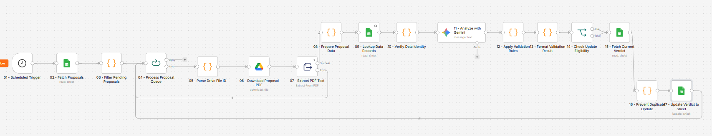

# AI-Powered Proposal Validator Using n8n & Gemini

An AI-powered workflow that automates proposal analysis, validation, and reporting using **n8n, Google Gemini, Google Drive, and Google Sheets**. This project demonstrates how AI-powered document analysis can be combined with rule-based validation, identity verification, and workflow automation to reduce repetitive manual reviews and support more efficient decision-making.

## Project Overview

Reviewing proposals manually can be time-consuming, especially when dealing with multiple submissions. Each proposal may require document extraction, participant verification, criteria evaluation, and status updates. This workflow automates those processes through a centralized pipeline built in n8n.

**Key capabilities:**
- Automated proposal retrieval from Google Sheets
- Google Drive PDF downloading and text extraction
- Participant identity verification against a reference database
- AI-powered document analysis using Google Gemini
- Rule-based validation against configurable criteria
- Automatic verdict and feedback generation
- Duplicate-update prevention
- Scheduled processing and error handling

## Workflow Overview

The workflow connects document processing, AI analysis, and structured validation into one automated system.

*Figure 1. End-to-end proposal validation workflow built with n8n.*

## How It Works

### 1. Proposal Collection

The workflow runs on a scheduled trigger and retrieves proposal submissions from Google Sheets. Only submissions with an empty or pending verdict are selected for processing.

### 2. Document Processing

Each selected submission is processed individually. The workflow retrieves the proposal PDF from Google Drive and extracts its text for analysis; PDFs without extractable text are handled separately to avoid sending empty documents to Gemini.

### 3. Identity Verification

Participant information is compared against a reference database to identify missing records or inconsistent identity details.

### 4. AI-Powered Analysis

Google Gemini analyzes the proposal and extracts structured information, such as participant counts, event duration, intended audience, and other evaluation criteria.

### 5. Rule-Based Validation

The extracted information is evaluated against configurable validation rules; Proposals that meet the requirements can receive a **Valid** verdict, while those with confirmed rule violations can receive an **Invalid** verdict. Proposals requiring additional information or manual review are not automatically finalized.

### 6. Automated Reporting

Completed validation results are written back to Google Sheets, including the final verdict and relevant feedback; Before updating, the workflow checks the current verdict to reduce duplicate or unnecessary updates.

## Technology Stack

| Technology | Purpose |
|---|---|
| n8n | Workflow orchestration and automation |
| Google Gemini | AI-powered proposal analysis |
| Google Sheets | Submission tracking and result management |
| Google Drive | PDF document storage and retrieval |
| JavaScript | Data transformation and rule-based validation |

## Getting Started

### Prerequisites

- An n8n instance
- Google Sheets access
- Google Drive access
- A Google Gemini API credential
- A Google Sheets document containing proposal submissions and participant reference data

### Installation

1. Download the workflow JSON from [`workflow/ai-proposal-validator.json`](workflow/smart-proposal-reviewer.json).
2. Open your n8n instance.
3. Create a new workflow.
4. Import the JSON file.
5. Configure the Google Sheets, Google Drive, and Gemini credentials.
6. Select your own spreadsheets and worksheets in the relevant nodes.
7. Adjust column mappings and validation criteria to match your use case.
8. Test the workflow with sample data before enabling scheduled execution.

### Example Google Sheets Structure

**Sheet 1: Proposal Submissions**

| Email | Full Name | Participant ID | Event | Proposal Link | Verdict | Feedback |
|---|---|---|---|---|---|---|
| student@example.com | Sample Student | P001 | AI Workshop | Google Drive PDF link | | |

**Sheet 2: Participant Database**

| Email | Full Name | Participant ID |
|---|---|---|
| student@example.com | Sample Student | P001 |

> **Note:** These are example structures. The worksheet names and column headers must match the expressions and mappings configured in the imported n8n workflow.

## Customization

This project is designed as a reusable automation template.

You can customize the workflow by modifying:

- **Validation criteria:** Minimum participant counts, event duration, target audience, and other requirements
- **Gemini instructions:** Analysis rules and expected structured output
- **Identity verification:** Reference fields used for matching
- **Processing limits:** Number of proposals processed per execution
- **Scheduling:** Frequency of automated checks
- **Feedback formatting:** How evaluation results are summarized

## Limitations

- Scanned or image-only PDFs may require OCR because standard PDF text extraction cannot always retrieve their contents.
- AI-generated analysis may contain errors and should be reviewed for high-impact decisions.
- Submissions requiring manual review may remain pending until further action is taken.
- Repeatedly failing submissions may be retried by later scheduled executions.
- Users must configure their own Google credentials and spreadsheet mappings before running the workflow.

## Security & Privacy

This repository is intended as a reusable workflow template and does not require access to the original project's data or credentials.

When adapting this project:
- Use your own API credentials and Google accounts.
- Never commit API keys, access tokens, or private identifiers.
- Use sample or anonymized data when publishing screenshots.
- Restrict access to spreadsheets and proposal documents appropriately.

## Project Purpose

This project was developed to explore how **AI-assisted document processing and workflow automation** can improve operational efficiency, reduce repetitive validation tasks, and create more structured review processes. It demonstrates the combination of operational problem-solving, AI integration, data validation, and automation engineering within a practical workflow.

## Disclaimer

This repository provides an adaptable workflow template rather than a fully configured deployment. Integrations and validation requirements must be configured and tested in the user's own environment before production use.

-Nata-
